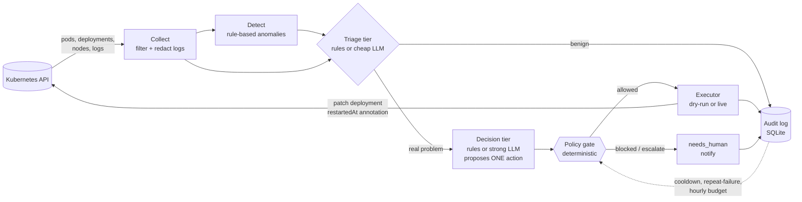

# k8s-guardian

[](https://github.com/Ctwqk/k8s-guardian/actions/workflows/ci.yml?query=branch%3Aportfolio-upgrade)

**A Kubernetes guardian that notices unhealthy workloads, triages their logs (rules or a two-tier LLM), and fixes only what an explicit policy allows. It is dry-run by default, rate-limited, and audits every decision.**

Most "AI ops" demos hand an LLM a shell. This one does the opposite: the model can only *propose* one of two actions
(`rollout_restart` or `do_nothing`), and a deterministic policy gate, which the model cannot influence, decides whether
anything touches the cluster.

## Features

- **Detects** crash loops, OOMKills, image-pull failures, stuck-pending pods, restart flapping, replica mismatches and node pressure from pod/deployment/node state.
- **Triages logs** (health-probe noise removed, repeats collapsed, secrets redacted) with a cheap tier, then asks a stronger tier for a single decision per workload. The tiers are either a **deterministic rule engine (default, no API keys)** or any **OpenAI-compatible endpoint**.
- **Policy-gated remediation**: allowlisted action, writable namespaces, per-workload rules, confidence threshold, cooldown, an "already restarted and still broken, so escalate to a human" guard, and an hourly budget.
- **Dry-run by default**; every decision (allowed or not) lands in a SQLite **audit log** that also backs the limits, so they survive restarts.
- Uses the official `kubernetes` Python client: no `kubectl` binary, no subprocess, no shell.
- HTTP API (`/api/status`, `/api/policy`, `/api/actions`, `POST /api/poll`), optional Discord notifications.
- Non-root slim image, kustomize manifests with a **read-only ClusterRole** and an opt-in, namespaced `patch deployments` Role.

**Tech stack:** Python 3.11+, FastAPI, pydantic / pydantic-settings, official `kubernetes` client, httpx, SQLite, pytest, ruff, mypy (strict), Docker, kustomize, GitHub Actions, kind.

## Architecture



One poll (default every 15 minutes), in code order (`k8s_guardian/engine.py`):

1. **Collect** pods, deployments, nodes (only namespaces the policy watches), then pod logs, falling back to the *previous* container's logs for restarted pods.
2. **Detect** with rules; anomalies of one workload are merged so each workload gets one decision per poll.
3. **Triage**: skipped (fast path) when error lines already explain every anomaly; otherwise the triage tier says whether anything is wrong. A benign verdict is audited as `triage_benign`.
4. **Pre-screen**: the gate is asked "could *any* restart be permitted for this workload right now?". If not (observe-only policy, read-only namespace, not restartable, cooldown, budget) no model call is made.
5. **Decide**: the decision tier proposes `rollout_restart` or `do_nothing` with a confidence.
6. **Gate**: the proposal is checked again, in order (table below).
7. **Act**: dry-run logs the would-be command; live mode patches the Deployment's pod-template annotation, the same thing `kubectl rollout restart` does.
8. **Audit and notify**: a row is written *before* the cluster is touched, then settled with the outcome.

## Safety model

| Layer | What it guarantees |
|---|---|
| **Hard action allowlist** (`models.py`) | Only `rollout_restart` and `do_nothing` exist. `delete_pod`, scaling, exec and anything a model invents are rejected, and a policy file that lists another action fails to load. |
| **Target comes from the observation** | The workload to restart is the one the detector saw. A decision naming a different target is `blocked_target`, whatever the model says. |
| **Policy file** | Per `namespace/workload` globs, first match wins, default is observe-only. `writable_namespaces` must be exact names. |
| **Only Deployments** | StatefulSets, DaemonSets, Jobs and ownerless pods are never restartable. `OOMKilled`, image-pull and node problems are never restartable (a restart cannot fix them). |
| **Dry-run by default** | `GUARDIAN_DRY_RUN=true` until you flip it. Dry-run rows never count against cooldown or budget. |
| **Cooldown, repeat-failure, budget** | After a live restart: wait `cooldown`; if it is still broken inside `repeat_window`, escalate to a human instead of restarting again; at most `max_actions_per_hour` live actions. Read from the audit DB. |
| **Untrusted model output** | JSON is schema-validated, confidence clamped, unknown actions rejected. Logs reach the model only after secret redaction, and a test feeds it a prompt-injection payload that the gate then refuses. |
| **Least-privilege RBAC** | Cluster-wide read (`get/list` pods, nodes, deployments; `get pods/log`), nothing else. The only write is `patch deployments` in namespaces you list. Verified on kind: see [`docs/rbac-check.txt`](docs/rbac-check.txt). |
| **Hardened container** | Non-root (uid 10001), read-only root filesystem, all capabilities dropped, seccomp `RuntimeDefault`. |

Gate outcomes (stored in the audit log's `result` column):

| Outcome | Meaning |
|---|---|
| `executed` / `failed` / `dry_run` | The restart ran, errored, or was only logged |
| `skipped` | Decision was `do_nothing` |
| `blocked_action` | Action not in the allowlist |
| `blocked_target` | Decision does not refer to the observed issue |
| `low_confidence` | Confidence below `GUARDIAN_CONFIDENCE_THRESHOLD` |
| `blocked_policy` / `blocked_namespace` / `blocked_name` | Policy forbids it, namespace not writable, unsafe resource name |
| `blocked_not_actionable` | A Deployment restart cannot fix this (OOM, image pull, StatefulSet, log-only evidence, ...) |
| `cooldown` / `repeat_failure` / `rate_limited` | Too soon after the last restart / restarted already and still broken, so escalate / hourly budget used |
| `triage_benign`, `llm_unavailable`, `deferred` | Triage cleared it / model tier unreachable (no action) / per-poll decision budget exhausted |

## Quickstart

Requires Python 3.11+ (tested on 3.11, 3.12, 3.13). No cluster or API key is needed for the first two steps.

```bash
git clone https://github.com/Ctwqk/k8s-guardian.git && cd k8s-guardian
python -m venv .venv && . .venv/bin/activate
pip install -e ".[dev]"

pytest -q                                   # 216 tests, no network, no keys

# One poll against the built-in demo cluster (fake backend), dry-run:
GUARDIAN_BACKEND=fake GUARDIAN_POLICY_FILE=examples/policy.demo.yaml \
  GUARDIAN_DB_PATH=/tmp/guardian-demo.db k8s-guardian once
```

Output (log lines go to stderr; the full JSON report is printed on stdout):

```
INFO guardian decision target=demo/batch-worker rule=oom_killed outcome=blocked_not_actionable needs_human=True reason=oom_killed on demo/batch-worker cannot be fixed by a Deployment restart
INFO guardian action target=demo/crashy-api rule=crash_loop outcome=dry_run detail=dry-run: would run `rollout restart deployment/crashy-api -n demo`
INFO guardian decision target=demo/payments-executor rule=crash_loop outcome=blocked_policy needs_human=True reason=policy forbids rollout_restart on demo/payments-executor: Pretend payment executor. Restarting could replay or drop orders; a human must review.
INFO guardian poll complete: pods=4 healthy=1 anomalies=3 error_lines=2 decisions=3 dry_run=True
```

Run it as a service against a real cluster you can reach with a kubeconfig (still dry-run, read-only):

```bash
export GUARDIAN_KUBECONFIG=~/.kube/config GUARDIAN_POLICY_FILE=examples/policy.demo.yaml
k8s-guardian serve &                        # API on :8000, polls every 15 min
curl -s localhost:8000/healthz
curl -s -X POST localhost:8000/api/poll     # poll now
curl -s localhost:8000/api/actions          # the audit log
```

Docker (the same image the manifests use):

```bash
docker build -t k8s-guardian:0.2.0 .
docker run --rm -e GUARDIAN_BACKEND=fake k8s-guardian:0.2.0 once
```

Validate a policy file before deploying it:

```bash
k8s-guardian check-policy examples/policy.demo.yaml
```

### Deploy to a cluster

```bash
docker build -t k8s-guardian:0.2.0 .
kind load docker-image k8s-guardian:0.2.0   # or push to a registry and edit `images:` in deploy/k8s/base/kustomization.yaml
kubectl apply -k deploy/k8s/base            # dry-run, observe-only policy, read-only RBAC
```

To allow live restarts, write a policy that lists the writable namespaces, put it in the `k8s-guardian-policy`
ConfigMap, grant the namespaced Role in [`deploy/k8s/overlays/demo/remediation-rbac.yaml`](deploy/k8s/overlays/demo/remediation-rbac.yaml)
for each of them, and set `GUARDIAN_DRY_RUN=false`. The demo overlay does exactly that for one namespace.
The base manifests were applied to a kind cluster and checked: the pod runs as uid 10001, `/api/status` reports
`dry_run: true` and policy `observe-only`, and `kubectl auth can-i` as the service account allows only the reads above.

## Demo: crash-looping pods on a kind cluster

[`scripts/kind-demo.sh`](scripts/kind-demo.sh) creates a throwaway kind cluster (private kubeconfig), deploys four workloads
([`examples/demo-workloads.yaml`](examples/demo-workloads.yaml)), deploys the guardian in live mode restricted to the
`demo` namespace, waits, asserts the outcome, and deletes the cluster. It is also the CI end-to-end job.

| Workload | Problem | Policy | Expected |
|---|---|---|---|
| `web` | healthy | | never touched |
| `crashy-api` | crash loop (`ERROR: cannot connect to redis`) | `demo/*`: restart allowed | restarted **once**, then cooldown, then **escalated** (a restart cannot fix a code bug) |
| `payments-executor` | crash loop | `demo/payments-*`: observe-only | never restarted, `blocked_policy` every poll |
| `batch-worker` | OOMKilled | | `blocked_not_actionable`, human needed |

Real run (kind v0.29.0, Kubernetes v1.33.1, poll interval 30 s, cooldown 60 s). Full transcript:
[`docs/demo-kind-transcript.txt`](docs/demo-kind-transcript.txt); raw audit rows: [`docs/demo-kind-actions.json`](docs/demo-kind-actions.json).

```
21:14:55 decision target=demo/crashy-api rule=log_issue outcome=blocked_not_actionable ...      (poll 1: not yet seen as crash-looping)
21:15:25 action   target=demo/crashy-api rule=crash_loop outcome=executed detail=deployment.apps/crashy-api restarted (restartedAt=2026-10-19T21:15:25+00:00)
21:15:55 decision target=demo/crashy-api rule=crash_loop outcome=cooldown needs_human=False reason=cooldown active for demo/crashy-api (29s remaining)
21:16:25 decision target=demo/crashy-api rule=crash_loop outcome=repeat_failure needs_human=True reason=demo/crashy-api was already restarted 60s ago and is still unhealthy; another restart is unlikely to help
every poll: demo/payments-executor outcome=blocked_policy       needs_human=True reason=policy forbids rollout_restart on demo/payments-executor: Pretend payment executor. ...
every poll: demo/batch-worker      outcome=blocked_not_actionable needs_human=True reason=oom_killed on demo/batch-worker cannot be fixed by a Deployment restart

web                  generation=1 restartedAt=-
crashy-api           generation=2 restartedAt=2026-10-19T21:15:25+00:00      <- the only change the guardian made to the cluster
payments-executor    generation=1 restartedAt=-
batch-worker         generation=1 restartedAt=-

PASS  crashy-api was restarted exactly once
PASS  crashy-api escalated to a human instead of restart-looping
PASS  payments-executor was blocked by policy on every poll
PASS  policy-protected / OOM workloads were never restarted
PASS  healthy web was never considered
```

Run it yourself (needs docker, [kind](https://kind.sigs.k8s.io), kubectl; takes several minutes):

```bash
scripts/kind-demo.sh                        # KEEP=1 keeps the cluster, CLUSTER=name picks its name
```

This demo uses the keyless rule analyzer. LLM mode was exercised against a local OpenAI-compatible **stub server**
(request shape, auth header, `<think>`/code-fence stripping, separate triage and decision models) and with fake
transports in the tests, but **not** against a real hosted model, so I make no claims about decision quality.

## Configuration

All settings are environment variables with the `GUARDIAN_` prefix (or a `.env` file; see [`.env.example`](.env.example)).
Invalid values fail at startup; `GET /api/config` shows the effective settings with secrets reduced to booleans.

| Variable | Default | Meaning |
|---|---|---|
| `GUARDIAN_BACKEND` | `kubernetes` | `kubernetes`, or `fake` (built-in demo cluster) |
| `GUARDIAN_KUBECONFIG`, `GUARDIAN_KUBE_CONTEXT` | unset | unset: in-cluster service account, then `$KUBECONFIG` / `~/.kube/config` |
| `GUARDIAN_DRY_RUN` | `true` | decide and audit but never change the cluster |
| `GUARDIAN_POLICY_FILE` | built-in | YAML policy (below). The built-in policy permits no remediation |
| `GUARDIAN_CONFIDENCE_THRESHOLD` | `0.6` | minimum confidence for an action |
| `GUARDIAN_COOLDOWN_SECONDS` | `600` | gap between live restarts of one workload |
| `GUARDIAN_REPEAT_WINDOW_SECONDS` | `3600` | restarted within this window and still broken: escalate instead |
| `GUARDIAN_MAX_ACTIONS_PER_HOUR` | `5` | live restart budget across all workloads |
| `GUARDIAN_MAX_DECISIONS_PER_POLL` | `3` | decision-tier calls per poll (bounds LLM spend and blast radius) |
| `GUARDIAN_POLL_INTERVAL_SECONDS` | `900` | poll period |
| `GUARDIAN_SNAPSHOT_INTERVAL_SECONDS`, `GUARDIAN_RETENTION_DAYS` | `900`, `7` | restart-count snapshots (for flapping) and audit retention |
| `GUARDIAN_DB_PATH` | `data/guardian.db` | SQLite audit log (`/data/guardian.db` in the image) |
| `GUARDIAN_PENDING_TIMEOUT_SECONDS` | `300` | pending longer than this is `stuck_pending` |
| `GUARDIAN_RESTART_FLAP_THRESHOLD` | `5` | restarts since ~1 h ago that count as flapping |
| `GUARDIAN_CRASH_LOOP_MIN_RESTARTS` | `3` | restarts before an `Error` exit counts as a crash loop |
| `GUARDIAN_REPLICA_MISMATCH_GRACE_SECONDS` | `120` | how long a Deployment may be under-replicated (rollouts) |
| `GUARDIAN_LOG_TAIL_LINES`, `..._LOG_SINCE_SECONDS`, `..._LOG_CONCURRENCY`, `..._LOG_MAX_PODS` | `50`, `900`, `5`, `100` | log collection bounds |
| `GUARDIAN_ANALYZER` | `rules` | `rules` (keyless) or `llm` |
| `GUARDIAN_LLM_BASE_URL`, `GUARDIAN_LLM_API_KEY` | | OpenAI-compatible endpoint (`.../v1`) and key. URL and models are required with `llm` |
| `GUARDIAN_LLM_TRIAGE_MODEL`, `GUARDIAN_LLM_DECISION_MODEL` | | cheap model / stronger model |
| `GUARDIAN_LLM_TIMEOUT_SECONDS`, `GUARDIAN_LLM_MAX_TOKENS` | `30`, `1024` | per-call limits |
| `GUARDIAN_DISCORD_WEBHOOK_URL`, `GUARDIAN_NOTIFY_COOLDOWN_SECONDS` | unset, `1800` | optional notifications, de-duplicated per target and rule |
| `GUARDIAN_API_TOKEN` | unset | when set, `POST /api/poll` needs `Authorization: Bearer <token>` |
| `GUARDIAN_HOST`, `GUARDIAN_PORT`, `GUARDIAN_LOG_LEVEL` | `0.0.0.0`, `8000`, `INFO` | server |

Coming from the single-file version? `LLM_BASE_URL` / `MINIMAX_API_BASE` are now `GUARDIAN_LLM_BASE_URL`,
`LLM_API_KEY` / `MINIMAX_API_KEY` are `GUARDIAN_LLM_API_KEY`, `MINIMAX_MODEL_TRIAGE` / `MINIMAX_MODEL_DECISION` are
`GUARDIAN_LLM_TRIAGE_MODEL` / `GUARDIAN_LLM_DECISION_MODEL`; `DISCORD_WEBHOOK_URL`, `POLL_INTERVAL_SECONDS` and
`SNAPSHOT_INTERVAL_SECONDS` gained the `GUARDIAN_` prefix; `GUARDIAN_MAX_ACTIONS_HOUR` is now
`GUARDIAN_MAX_ACTIONS_PER_HOUR`. The old hard-coded policy is preserved as
[`examples/policy.constructure.yaml`](examples/policy.constructure.yaml).

### Policy file

```yaml
version: demo-1
watched_namespaces: ["*"]
ignored_namespaces: [kube-system, kube-public, kube-node-lease]   # never watched, never writable
writable_namespaces: [demo]                                       # exact names only; the only places a restart can happen
rules:                                                            # first match wins; globs on namespace and workload
  - {namespace: demo, workload: "payments-*", allowed_actions: [do_nothing], reason: A human must review.}
  - {namespace: demo, workload: "*", allowed_actions: [rollout_restart, do_nothing], reason: Stateless.}
default_rule: {allowed_actions: [do_nothing], reason: No rule grants remediation.}
```

## HTTP API

| Endpoint | |
|---|---|
| `GET /healthz` | liveness/readiness (does not depend on the cluster) |
| `GET /health` | was the last poll ok? |
| `GET /api/status` | pods, anomalies, cooldowns, budget, models, last triage |
| `GET /api/policy` | effective policy and limits |
| `GET /api/actions?limit=&offset=` | the audit log, newest first |
| `GET /api/config` | effective settings, secrets redacted |
| `POST /api/poll` | run a poll now and return the full report (token-protected if configured) |

## Project layout

```
k8s_guardian/
  config.py       typed settings (pydantic-settings)         engine.py     the poll cycle
  models.py       data models, action allowlist              policy.py     policy file + PolicyGate
  collectors.py   snapshot + log collection, filter, redact  analysis.py   rule analyzer, LLM analyzer, prompts
  detector.py     rule-based anomaly detection               llm.py        OpenAI-compatible client
  executor.py     the only code that changes the cluster     audit.py      SQLite audit log and limits
  notify.py       Discord webhook                            api.py, cli.py, bootstrap.py
  cluster/        backend protocol; kube.py (official client), fake.py, parse.py
tests/            pytest suite                               deploy/k8s/   base + demo overlay
examples/         policies, demo workloads                   scripts/kind-demo.sh   e2e / demo
docs/             captured demo transcript, RBAC check
```

## Development

```bash
pip install -e ".[dev]"
ruff check . && ruff format --check . && mypy      # lint, format, strict types
pytest --cov                                        # 216 tests, ~98% line coverage
```

The suite uses a fake cluster, a scripted fake model (including hostile ones), `httpx.MockTransport` for the LLM and
Discord, and an in-process fake API server so the real `KubernetesBackend` is exercised end to end. CI
([`.github/workflows/ci.yml`](.github/workflows/ci.yml)) runs lint, types and tests on Python 3.11 to 3.13, builds
and smoke-tests the Docker image, renders the manifests, and runs the kind end-to-end demo.

## Design notes and trade-offs

- **A gate, not guardrails in the prompt.** The prompt asks the model to be conservative, but nothing relies on it: the gate re-derives target, policy, namespace and limits from observed state and the audit log. The pre-screen reuses the same gate, so "can any restart happen?" has one source of truth, and it saves model calls.
- **Rules by default.** The rule analyzer mirrors the prompt guidance deterministically, so the project runs, is testable and is useful without keys. The LLM tiers add judgement (benign vs real, log context), not authority.
- **Official client over `kubectl`.** No binary to ship or pin, no argument-injection surface, typed errors, and a patch that maps 1:1 to `rollout restart`.
- **Audit log as state.** Cooldown and budget are queried from SQLite instead of process memory, so a crash-restart cannot reset them; an `allowed` row is written before acting, so a crash mid-action still counts. Cost: one writer, hence one replica (`strategy: Recreate`).
- **One decision per workload per poll**, highest severity first, bounded by `max_decisions_per_poll`.
- **Polling, not watches.** Simple and cheap; slow to notice (15 min by default) but easy to reason about.

## Known limitations

- The only action is a Deployment rollout restart (scaling and deleting are deliberately absent). StatefulSets, DaemonSets and Jobs are observe-only.
- It does not look at rollout history, so a crash loop right after a bad deploy is treated like any other: one restart, then escalation. (The LLM prompt mentions this case; the rule analyzer cannot see it.)
- Secret redaction is regex-based and best effort. With `GUARDIAN_ANALYZER=llm`, filtered logs of **all watched pods** are sent to your endpoint on every poll that has logs; use a local or trusted endpoint.
- LLM decision quality is untested against a real model; Discord delivery is untested against real Discord (mocked transports only).
- Read endpoints (`/api/status`, `/api/actions`) are unauthenticated and list workload names; keep the Service cluster-internal. There is no metrics endpoint and no leader election.
- The guardian watches its own namespace unless the policy ignores it; its own INFO log lines are filtered so it does not read them back as evidence.

## Roadmap

Prometheus metrics; rollout-history awareness (hold off right after a spec change, policy-gated `rollout undo`); watch-based triggers; HA via leader election and a shared database; a Helm chart; an offline evaluation harness for LLM decisions; generic webhook and Slack notifiers.

## Origin

Started in March 2026 as a single `app.py` (FastAPI, `kubectl` subprocesses, and a hard-coded policy for the author's k3s
cluster). The October 2026 rewrite keeps the idea and flow (two-tier triage and decision, rule-based detection,
controlled remediation, cooldown, rate limit) and moves them into the package above. One thing the old file could not
do: its poll loop called a function that was never defined, so no poll ever completed.
